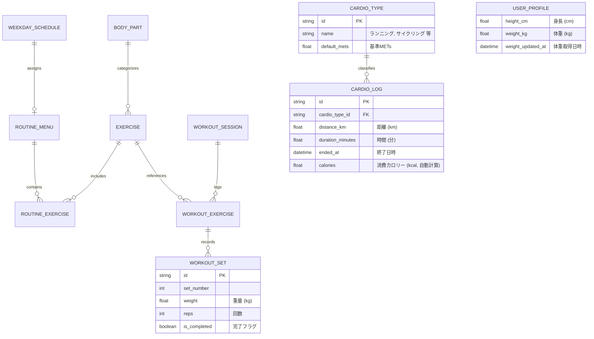

# Workout Logger 要件定義書（v1.3）

本書は、iPhoneブラウザ（Safari等、PWA対応）での利用に特化した筋トレ・有酸素記録Webアプリケーション「**Workout Logger**」の要件定義書です。  
ユーザーのフィードバックに基づき、**不要な機能（種別、経過時間、総ボリューム）を徹底的に削ぎ落とし**、**有酸素運動記録（カロリー自動計算）**、**上のSetからの完全コピー（重量・回数・完了フラグ）**、**身長・体重設定（Appleヘルスケアからの体重取得）**を追加した最新仕様です。

---

## 1. プロジェクト概要

### 1.1 アプリ名
**Workout Logger**

### 1.2 目的・コンセプト
- **利用環境**: **iPhoneブラウザをメインターゲットとしたWebアプリケーション**（PWA対応）。
- **徹底したミニマリズム**:
  - タイマーや総ボリューム計算、セット種別（ウォームアップ等）の管理を排除し、**「何を・何kgで・何回挙げたか」「有酸素をどれだけやったか」**の記録に純化。
  - ジムのインターバル中に片手で迷わず記録できる操作性を最優先。
- **データ・システム構成（パターンA）**:
  - **フロントエンド**: Vite + React + TypeScript + Tailwind CSS (PWA)。完全無料、オフラインファースト。
  - **バックエンド / DB**: Googleスプレッドシート ＋ GAS。PCから直感的に閲覧・編集可能。
  - **Appleヘルスケア連携**: iOSショートカット経由で「体重取得」および「ワークアウト書き込み」に対応。

---

## 2. 機能要件一覧

### 2.1 筋力トレーニング記録（Strength Logging）
- [ ] **F-101 セッション管理**:
  - ワークアウトの開始・完了。
  - 日付跨ぎ（深夜トレ）対応。
- [ ] **F-102 種目・セット入力（ミニマル仕様）**:
  - 各セットの入力項目: **重量 (kg) / 回数 (reps) / 完了フラグ (チェックボックス)** のみ。
  - ※「種別（通常/W/D/F）」は排除し、余計な選択肢を無くしてシンプル化。
  - 自重トレーニング対応（加重・自重）。
- [ ] **F-103 片手高速入力 & Setコピー機能（強化）**:
  - **前回の記録のフロート表示**: テーブル内にPrevious列を置かず、種目横の「履歴(🕒)」ボタンで前回の全セット実績をフロート表示。
  - **上のSetからの完全コピーボタン**:
    - **`上のSetをコピー (重量・回数・完了)`**: 上のセットの「重量」「回数」「完了チェック」をすべてワンタップで次のセットへ反映。
    - **`重量のみコピー`** / **`回数のみコピー`**: 必要に応じて一部のみコピーも可能。
  - 専用大型テンキー ＋ クイック増減ボタン（`+1.25kg`, `+2.5kg`, `+5kg`, `+1rep`）。
  - 1RM自動計算表示（参考値としてテンキー上部に表示）。

> **※除外された機能**:
> - ~~セット種別機能（Normal/Warmup/Drop/Failure）~~: 完全削除。
> - ~~経過時間の計測機能（タイマー）~~: 完全削除。
> - ~~総ボリューム機能（総重量計算・表示）~~: 完全削除。
> - ~~インターバルタイマー~~: 削除済み。
> - ~~体組成記録（アプリ単体での記録）~~: 体重・身長は設定に集約。
> - ~~プレート計算機 / SNSシェア~~: 削除済み。

---

### 2.2 有酸素運動記録（Cardio Logging）★新規追加
- [ ] **F-201 有酸素運動の記録**:
  - 記録項目:
    - **種別**: ランニング、サイクリング、ウォーキング（初期プリセット ＋ 自由追加可能）
    - **距離**: km
    - **時間**: 分
    - **終了日時**: 日時（デフォルトは現在日時）
    - **消費カロリー**: **自動計算（kcal）**
- [ ] **F-202 消費カロリー自動計算ロジック**:
  - 設定されている「体重 (kg)」と、実施した種別（METs値）、時間、距離（速度）をもとに、科学的根拠（厚生労働省「健康づくりのための身体活動・運動ガイド」および Compendium of Physical Activities のMETs換算式）に基づき、安静時代謝を除いた**アクティブ消費カロリー**をリアルタイム自動計算（Appleヘルスケアのアクティブエネルギーと整合）。
  - 計算式: $\text{アクティブ消費カロリー (kcal)} = 1.05 \times \max(0, \text{METs} - 1.0) \times \text{体重(kg)} \times \left(\frac{\text{時間(分)}}{60}\right)$
  - 種別ごとのMETs算出（標準3種目は時速に応じた連続線形補間、カスタム種目は設定された基準METsを優先）:
    - ウォーキング: 基準 3.8 METs（速度連動: 1.8〜10.1 METs）
    - ランニング: 基準 8.3 METs（速度連動: 3.6〜24.3 METs）
    - サイクリング: 基準 6.8 METs（速度連動: 2.4〜23.4 METs）
- [ ] **F-203 有酸素種別のマスタ管理（追加可能）**:
  - ユーザーが独自の有酸素種別（例: 水泳、ステアマスター、エリプティカル、ローイングなど）を自由に追加・編集可能。

---

### 2.3 トレーニングメニュー・曜日別スケジュール（Routines）
- [ ] **F-301 曜日別デフォルトメニュー設定**:
  - 月〜日曜の各曜日にデフォルトメニュー（例: 月曜=Push A、水曜=Pull A、金曜=Legs、他=オフ）を割り当て。
- [ ] **F-302 メニューテンプレート管理**:
  - メニューの作成・編集（種目リスト、目標セット数・レップ数）。
- [ ] **F-303 今日のメニュー自動サジェスト**:
  - 当日の曜日のメニューを筋トレ画面のメニュー一覧で「本日の予定」としてハイライト表示し、1タップで開始。

---

### 2.4 体組成・体重推移（Body Composition & Trends）★新規追加（旧ホームタブから置換）
- [ ] **F-401 Appleヘルスケアからの体組成データ取得（読み取り専用）**:
  - ナビゲーション左端の「体組成」タブ（旧「ホーム」タブを廃止して置換、アプリ起動時の初期表示は「筋トレ」タブ）にて、**体重 (kg)・筋肉量（除脂肪体重, kg）・体脂肪率 (%)** の推移を閲覧。
  - データは iOSショートカット（`GetWeightFromHealth`）経由で Appleヘルスケアから共有してもらうのみで、本アプリからヘルスケアへ体組成データをアップロードすることはない。
- [ ] **F-402 グラフ可視化 ＆ 日別 / 週平均 / 月平均 切り替え**:
  - **集計単位**: 「**日別**」「**週平均**」「**月平均**」をワンタップで切り替え可能（週平均・月平均時は期間内の最小〜最大レンジ帯および計測日数も表示）。
  - **期間フィルタ**: 「1ヶ月」「3ヶ月」「半年」「1年」「全期間」の切り替え、および「単一グラフ拡大表示 / 3項目同時表示」に対応。

---

### 2.5 設定 & Appleヘルスケア連携（Settings & HealthKit）★強化
- [ ] **F-501 身長・体重の設定**:
  - 設定画面で「身長 (cm)」および「体重 (kg)」を設定・保存。有酸素のカロリー計算に活用（ヘルスケアから最新体重を取得した際にも自動更新）。
- [ ] **F-502 Appleヘルスケアへのワークアウト書き込み**:
  - 筋トレ・有酸素の終了時、iOSショートカット経由でヘルスケアへアクティビティを自動記録。
- [ ] **F-503 Googleスプレッドシート（GAS）設定**:
  - GAS Web App URL の設定、最新マスタ・履歴（体組成データを含む）の双方向同期。

---

## 3. Googleスプレッドシート設計（更新版）

| シート名 | カラム構成 | 説明 |
| :--- | :--- | :--- |
| **`schedule`** | `day_of_week`, `day_name`, `menu_id` | 曜日別メニュー割当 |
| **`menus`** | `menu_id`, `menu_name`, `target_parts`, `sort_order` | メニューマスタ |
| **`menu_exercises`** | `menu_id`, `exercise_id`, `order_index`, `target_sets`, `target_reps` | メニュー構成種目 |
| **`exercises`** | `exercise_id`, `body_part`, `exercise_name`, `equipment`, `note` | 筋トレ種目マスタ |
| **`workouts`** | `session_id`, `started_at`, `ended_at`, `menu_name`, `note` | ワークアウトセッション履歴（時間・ボリューム項目を排除） |
| **`sets`** | `session_id`, `exercise_name`, `set_number`, `weight_kg`, `reps`, `is_completed`, `completed_at` | セット詳細（種別を排除し、完了フラグを追加） |
| **`cardio_types`** | `type_id`, `name`, `default_mets` | 有酸素種別マスタ（ランニング等） |
| **`cardio_logs`** | `log_id`, `cardio_type_name`, `distance_km`, `duration_min`, `calories_kcal`, `ended_at` | 有酸素運動履歴 |
| **`body_metrics`** | `date`, `weight_kg`, `muscle_mass_kg`, `body_fat_pct`, `measured_at`, `note` | 体組成推移履歴（体重・筋肉量・体脂肪率） |

---

## 4. データモデル設計（ER図）

